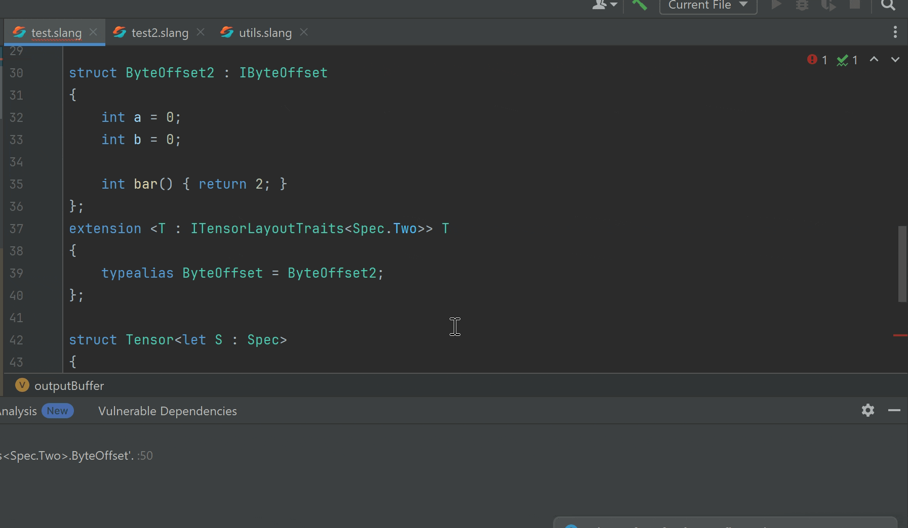

### This is a Refined Unofficial Slang LSP

---

### Example


---

### Base JetBrains plugin distribution page
https://plugins.jetbrains.com/plugin/26239-slang-unofficial-
This plugin was forked from that one, all the props to the author, I refined it and added a lot of features that I personally needed.
If you want any additional features, please open an issue on github and I will try to add it ASAP.

---

### To Build
1. Install IntelliJ IDEA and JDK 21 or newer
2. Fetch code with `git clone --recursive https://github.com/16-Bit-Dog/slang-intellj-extenson.git`
3. Release builds use IDEA 2024.2.6. For local development, pass `-PlocalIdePath=/path/to/intellij-idea` to Gradle.
4. Open the project in IDEA, select the Gradle wrapper and a supported JDK (21–27) as the project/Gradle JVM, then run the `test` and `buildPlugin` tasks. Compilation targets Java 21.
5. Install the plugin ZIP from `build/distributions/`

---

### Language server
Use a current `slangd` installation. Configure the server directory in Settings → Tools → Slang → General, or make it available through vcpkg or PATH.

---

### Formatting
Install `clang-format`, then open Settings → Tools → Slang → Formatting. Leave the executable field empty to search PATH, or enter its full path.

**Editor → Code Style → Slang** controls tabs, indentation, continuation indentation, line length, and opening-brace placement.
Use **Set from** to select **Slang (upstream)** (the default, following shader-slang v2026.22's
[`.clang-format`](https://github.com/shader-slang/slang/blob/v2026.22/.clang-format): four-space indentation,
100 columns, Allman braces) or **Java-style (K&R)** (attached braces and eight-space continuation indentation).
These presets are editable and stored in the IDE's code-style scheme.

With formatter **Style** set to `file`, a project's `.clang-format` takes precedence.
Leave **Fallback style** empty to use the Slang code-style settings when no configuration file is found.
Existing non-empty style overrides remain supported. Smart typing uses the IDE indentation settings;
brace placement is applied by explicit formatting and reformat-on-paste.

New projects start with no predefined macros. Existing project macros remain editable under General; examples are shown as help text rather than definitions.

### Smart editing
Slang provides local bracket and quote pairing, paired deletion, selection wrapping, smart Enter and Backspace,
comment continuation, closing-brace indentation, and paste indentation. These follow **Editor → General → Smart Keys**
and the IDE's indentation options. Enter in a populated inline body expands it onto separate lines.

Generic angle-bracket pairing understands Slang's `name<T>`, `__generic<T>`, and `extension<T>` forms,
including value parameters, type packs, nested arguments, paired deletion, type-over, selection wrapping,
and Tab-out. It recognizes local declarations, directly imported indexed declarations, and common built-in
generic types. Comparisons and shifts remain operators; unresolved or expensive symbol lookups are left
unpaired rather than guessing from capitalization. Generic argument lists also support multiline indentation.

Ordinary typing does not request server-side on-type formatting, so entering a statement does not unexpectedly
rewrite its surrounding spaces. Explicit formatting and reformat-on-paste use the configured formatter.

---

### Rename
Use Refactor → Rename on a Slang identifier. When `slangd` supports rename, LSP4IJ handles it directly. Otherwise, the plugin verifies matching occurrences through go-to-definition and opens a native preview before changing the declaration and its usages together. The change supports Undo and includes unsaved edits.
The fallback searches project `.slang` and `.slangh` files under the current server configuration. It cannot check inactive code, external references, or new-name conflicts. Built-in/external declarations, ambiguous targets, and declarations the server cannot verify are rejected. If project files change during the search or preview, run Rename again.

---

### Unused symbols
Structs, functions, fields, globals, and supported local variable declarations with no references in project Slang files use the IDE's unused-symbol style. Analysis runs in the background and reuses the reference finder. Public declarations are checked across project Slang files. Shader entry points and explicitly exported/external declarations are excluded; unresolved reference candidates are left unmarked.

Under **Settings → Tools → Slang → General**, **Check unused symbols** enables the plugin analysis and is checked by default. Uncheck it to disable the plugin analysis. Server diagnostics remain enabled in either mode.

The fallback cannot see usage outside project Slang files, host-side resource bindings, or inactive configurations. Local declaration discovery is conservative; function bodies containing preprocessor directives are skipped. This checks references, not whether a variable's value is ever read or a function is reachable from an entry point.

---

### To Run Tests
The test suite includes native language-server integration and real vcpkg installation/discovery tests. Prerequisites:

- JDK 21 or newer.
- The `VCPKG_ROOT` environment variable set to a bootstrapped vcpkg checkout. Gradle runs the executable in that directory; it does not need to be on `PATH`.
- CMake, Ninja, and the native build toolchain required by `shader-slang`.

Gradle's `installTestDependencies` task installs `shader-slang` and prebuilt `clang-format` into `vcpkg_installed/` before tests run. No separate Slang, clang-format, or Python installation is needed, and clang-format does not build LLVM from source. Subsequent runs reuse vcpkg's installed packages and caches. Missing prerequisites fail the run rather than skipping integration tests.

**`builtin-baseline` in `vcpkg.json` is the single version selector.** Before installation, `generateClangFormatPort` reads LLVM's version from that exact official vcpkg commit, resolves the same clang-format release on PyPI, verifies the archive against PyPI's SHA-256 digest, and generates a SHA-512-pinned overlay port under `build/generated/vcpkg-ports/clang-format/`. The generated `provenance.json` records the baseline, version, URL, and checksums.

Changing only `builtin-baseline` regenerates the overlay on the next **Run Tests**, and vcpkg installs the matching tools. Discovery fixtures also read that same manifest. If the new baseline selects the same LLVM version, clang-format naturally stays at that version. Keep your local vcpkg checkout updated so its version index includes the selected official packages.

Prebuilt binaries come from the community [ssciwr clang-format-wheel distribution](https://github.com/ssciwr/clang-format-wheel) on PyPI. The native executable is extracted directly; pip and Python wrappers are not used. Supported hosts are x64/arm64 Windows and macOS, and glibc Linux. OS/runtime minimums depend on the chosen release (23.1.5 requires glibc 2.27+ on x64 and 2.26+ on arm64). Missing, yanked, or ambiguous matching binaries fail clearly; there is no LLVM source-build or alternate-version fallback. Generating a new overlay requires network access; unchanged task inputs reuse it.

In IDEA, select the shared **Run Tests** configuration. It inherits `VCPKG_ROOT` from IDEA's environment, runs Gradle's `test` task, and displays test results and standard output/error in the Run tool window. It forces tests to run even when Gradle considers them up to date. Reports are saved under `build/reports/tests/test/`, with machine-readable results under `build/test-results/test/`; no shell redirection to `/tmp` is used.

**On Windows:**
```powershell
.\gradlew.bat test
```

**On macOS/Linux:**
```bash
./gradlew test
```

### vcpkg discovery project bundle

Run the self-contained project fixtures for CMake, MSBuild, Xmake, and Meson:

```bash
./gradlew test --tests '*VcpkgProjectBundleTest' --rerun
```

The bundle generates temporary project files and vcpkg installation trees, then calls the plugin's production discovery code. It checks custom paths with spaces, all three conventional install directories in priority order, host-versus-target selection, missing servers, and Windows executable naming.

The real-install test uses the same vcpkg checkout, installs `shader-slang` into a temporary custom directory, configures CMake, and asks every adapter to locate the real installed `slangd`. Its baseline matches the root manifest. MSBuild, Xmake, and Meson use generated metadata fixtures; their build tools are not invoked. Windows executable naming on a non-Windows machine is likewise a fixture test, not a Windows build.

Temporary projects are cleaned up by JUnit. The root `vcpkg_installed/` directory and vcpkg's download/build/binary caches persist for reuse. Results are in `build/reports/tests/test/index.html`. For IDE test runs, use the Gradle test runner so dependency installation and test properties are configured.
