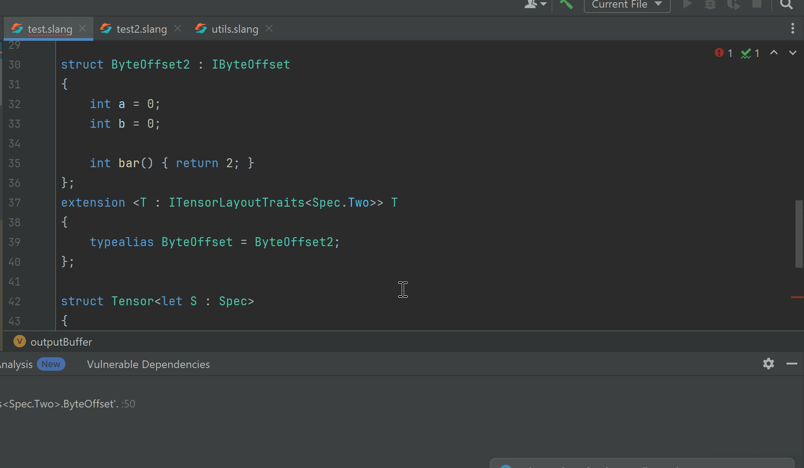

### This is a Refined Unofficial Slang LSP

---

### Example


---

### Base JetBrains plugin distribution page
https://plugins.jetbrains.com/plugin/26239-slang-unofficial-
This plugin was forked from that one, all the props to the author, I refined it and added a lot of features that I personally needed.
If you want any additional features, please open an issue on github and I will try to add it ASAP.

---

### To Build
1. Install IntelliJ IDEA and JDK 21 or newer
2. Fetch code with `git clone --recursive https://github.com/16-Bit-Dog/slang-intellj-extenson.git`
3. Release builds use IDEA 2024.2.6. For local development, pass `-PlocalIdePath=/path/to/intellij-idea` to Gradle.
4. Open the project in IDEA, select the Gradle wrapper and a supported JDK (21–27) as the project/Gradle JVM, then run the `test` and `buildPlugin` tasks. Compilation targets Java 21.
5. Install the plugin ZIP from `build/distributions/`

---

### Language server
Use a current `slangd` installation. Configure the server directory in Settings → Tools → Slang → General, or make it available through vcpkg or PATH.

---

### Formatting
Install `clang-format`, then open Settings → Tools → Slang → Formatting. Leave the executable field empty to search PATH, or enter its full path.
New projects start with no predefined macros. Existing project macros remain editable under General; examples are shown as help text rather than definitions.

---

### Rename
Use Refactor → Rename on a Slang identifier. When `slangd` supports rename, LSP4IJ handles it directly. Otherwise, the plugin verifies matching occurrences through go-to-definition and opens a native preview before changing the declaration and its usages together. The change supports Undo and includes unsaved edits.
The fallback searches project `.slang` and `.slangh` files under the current server configuration. It cannot check inactive code, external references, or new-name conflicts. Built-in/external declarations, ambiguous targets, and declarations the server cannot verify are rejected. If project files change during the search or preview, run Rename again.

---

### To Run Tests
The small test suite covers numeric lexing, settings persistence, executable discovery, language isolation, and an optional real-server smoke test. Run it with the included Gradle wrapper (requires JDK 21):

**On Windows:**
```cmd
./gradlew test
```

To also test import resolution through a real language server, set `SLANGD_TEST_EXECUTABLE`
to the absolute path of `slangd` before running the tests. This checks configured
include paths, configuration replies, cross-file go-to-definition, hover, and
semantic tokens over LSP.

**On macOS/Linux:**
```bash
./gradlew test
```
